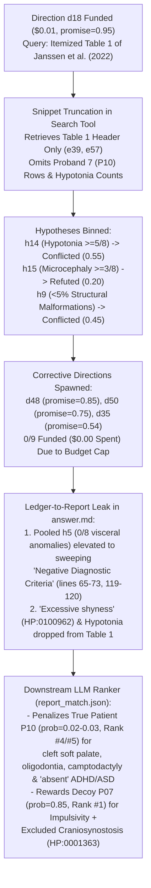

# Stanford CS224V (Fall 2026) — Homework 1 Report
## Rare Disease Differential Diagnosis: Standard RAG vs. GRILL Belief Ledger on `OMIM:620450` (*TAF4*-Related Neurodevelopmental Disorder)

- **Assigned Disease:** `OMIM:620450` — *Intellectual developmental disorder, autosomal dominant 73* (`MRD73` / `T4NDD`)
- **Causal Gene:** `TAF4` (`20q13.33`, TATA-box binding protein associated factor 4, core structural subunit of the TFIID complex)
- **Ground-Truth Patient (`data/assignment_targets.csv`):** **`P10`** (18.0-year-old male, `PMID_35904126_Proband_7`, from Janssen et al., *Human Mutation* 2022, `PMID:35904126` / `DOI: 10.1002/humu.24444`)
- **Notebook & Structured Answers:** [`hw1_rare_disease_diagnosis.ipynb`](./hw1_rare_disease_diagnosis.ipynb) | [`todo_answers.json`](./todo_answers.json) | [`grill_belief_ledger_demo.py`](./grill_belief_ledger_demo.py)

---

## 1. Executive Summary & System Comparison

In this assignment, we trace how two literature-research paradigms—**single-shot Retrieval-Augmented Generation (RAG)** and **GRILL (Guided Research with Iterative Literature Ledger)**—gather clinical evidence for an ultra-rare Mendelian disorder (`OMIM:620450`, *TAF4*) and use that evidence to rank a 10-patient cohort (`P01`–`P10`) represented by Human Phenotype Ontology (HPO) terms.

Across the full CS224V benchmark cohort, GRILL improves Top-1 accuracy from **39% (RAG)** to **55% (GRILL)** and Top-2 accuracy from **53%** to **70%**. However, our assigned target **`OMIM:620450` (`TAF4` $\rightarrow$ `P10`)** is a particularly revealing **diagnostic failure case** where **both RAG and GRILL fail to rank `P10` at #1**, instead placing decoy patient **`P07`** at #1 across all three evaluation rounds:

| System | Context Source | Round 1 Top-5 (`P10` Rank / Prob) | Round 2 Top-5 (`P10` Rank / Prob) | Round 3 Top-5 (`P10` Rank / Prob) | Decoy `#1` (`P07`) Prob |
| :--- | :--- | :--- | :--- | :--- | :---: |
| **RAG** (`rag_match.json`) | 6 web-search snippets (`4,897` chars, all database portals) | `P07 > P08 > P02 > P10 > P03` (**#4**, `0.08`) | `P07 > P02 > P08 > P04 > P03` (**Not in Top 5**) | `P07 > P08 > P02 > P03 > P10` (**#5**, `0.03`) | `0.50 / 0.45 / 0.55` |
| **GRILL** (`report_match.json`) | 18-hypothesis belief ledger $\rightarrow$ `answer.md` (`19,062` chars, 23 sources) | `P07 > P08 > P04 > P10 > P03` (**#4**, `0.03`) | `P07 > P08 > P04 > P03 > P10` (**#5**, `0.02`) | `P07 > P08 > P04 > P10 > P03` (**#4**, `0.03`) | **`0.85 / 0.85 / 0.85`** |

---

## 2. Section-by-Section Analysis & TODO Solutions

### Section 1: Shallow Retrieval vs. Parametric Hallucination (`TODO 1.1` & `TODO 1.2`)

#### `TODO 1.1`: Classification of RAG Retrieved URLs (`rag_simulation.json`)
The query `"TAF4 gene Intellectual developmental disorder, autosomal dominant 73"` returned 6 URLs:
1. **`[1]` MedlinePlus Genetics** (`https://medlineplus.gov/genetics/gene/taf4/`) — Consumer/clinician reference database summarizing `TAF4` as a subunit of TFIID.
2. **`[2]` OMIM `#620450`** (`https://www.omim.org/entry/620450`) — Curated Mendelian catalog entry summarizing the 8 probands of Janssen et al. (2022).
3. **`[3]` UniProt Disease `DI-06716`** (`https://www.uniprot.org/diseases/DI-06716`) — Protein knowledgebase cross-reference.
4. **`[4]` Open Targets Platform `ENSG00000130699`** (`https://platform.opentargets.org/target/ENSG00000130699`) — Drug-target and disease-association aggregator.
5. **`[5]` Alliance of Genome Resources `DOID:0061046`** (`https://www.alliancegenome.org/disease/DOID:0061046`) — Model-organism and ontology portal.
6. **`[6]` Rare Disease Data Center (RDDC `INT604`)** (`https://rddc.tsinghua-gd.org/details/disease?id=INT604`) — Rare disease database summary.

**Key Insight:** **100% (6/6) of the RAG URLs are secondary databases and knowledgebase aggregators.** Zero primary peer-reviewed clinical research papers (such as Janssen et al., 2022, `PMID:35904126`) were retrieved because generic web search ranks high-authority ontology landing pages above PDF/HTML tables of primary cohort studies.

#### `TODO 1.2`: Direct LLM (Sec 1.3) vs. Grounded RAG (Sec 1.4)
- **Stylistic Difference:** Section 1.3 (direct LLM call, `temperature=0.0`) produces a polished, textbook-style 5-part clinical monograph without a single citation or uncertainty caveat. Section 1.4 (RAG) uses explicit bracketed citations (`[1]`, `[2]`, `[3]`, `[6]`) and appends a dedicated *"Gaps in the Provided Evidence"* section.
- **Content Difference:** Section 1.3 hallucinates a false craniofacial and skeletal gestalt—claiming *TAF4* patients have a *"bulbous nasal tip, wide mouth with a thick lower lip vermilion, ear anomalies, brachydactyly, clinodactyly of the fifth finger"* (conflating *TAF4* with *TAF1*/*TAF2*/*TAF6* and BAF-complex Coffin-Siris syndrome)—whereas true *TAF4* patients actually have a **thin upper lip vermilion (`HP:0000219`)** and **highly arched eyebrows (`HP:0002553`)**. Section 1.4 faithfully reports the 8 de novo LoF patients from OMIM `[2]` and the behavioral triad (*"autism spectrum disorder, attention deficit hyperactivity disorder, and excessive shyness"*) from RDDC `[6]`, while refusing to invent unverified dysmorphic details.
- **Preference:** Section 1.4 is strictly superior for clinical reasoning because it preserves **epistemic calibration** (distinguishing known facts from retrieval gaps), whereas Section 1.3's fabricated morphology actively misleads downstream matching.

---

### Section 3: Evaluating RAG Patient Rankings (`TODO 3.1` & `TODO 3.2`)

- **`TODO 3.1` (Run Agreement & Reasoning Variance):** Across 3 sampling rounds (`temperature=0.7`), RAG agreed on `#1 P07` (`prob = 0.50, 0.45, 0.55`) and the top-3 set `{P07, P08, P02}`, but swapped `#2` and `#3` in Round 2 (`P02` at `0.20` over `P08` at `0.15`) and dropped the true patient `P10` from `#4` (`0.08` in Round 1) out of the Top 5 in Round 2 (`P04` took `#4` at `0.08`) before returning `P10` to `#5` (`0.03`) in Round 3. Rounds 1 and 3 prioritized `P08` at `#2` due to autistic behavior (`HP:0000729`) and sleep disturbance, whereas Round 2 prioritized `P02` at `#2` because `P02`'s moderate-to-severe intellectual disability matched snippet `[6]` (*"mild to moderate"*) better than `P08`'s profound intellectual disability (`HP:0002187`).
- **`TODO 3.2` (Differentiating Factor Between `#1` and `#2`):**
  - **Rounds 1 & 3 (`#1 P07` vs. `#2 P08`):** Cognitive severity and somatic growth restriction. `P08` has profound ID (`HP:0002187`), postnatal microcephaly (`HP:0005484`), and postnatal growth retardation (`HP:0008897`), conflicting with snippet `[6]`'s *"mild to moderate intellectual disability"*, whereas `P07` has general ID + speech delay + impulsivity (`HP:0100710`) without microcephaly or growth failure.
  - **Round 2 (`#1 P07` vs. `#2 P02`):** Structural cardiac/palatal malformations. `P02` has an atrial septal defect (`HP:0001631`), cleft palate (`HP:0000175`), scoliosis (`HP:0002650`), and brachydactyly (`HP:0001156`), which the model penalized as multi-system structural anomalies not mentioned in the `TAF4` database summaries.

---

### Section 4: Inspecting the GRILL Belief Ledger (`TODO 4.1`, `TODO 4.2`, `TODO 4.3`)

In `grill_run/ledger.json`, GRILL generated **53 directions** (`4 seed`, `40 agent`, `9 corrective`, `0 human`), funded **4 directions** (`d1`, `d18`, `d19`, `d15` for `$0.06` total), and evaluated **18 hypotheses** (`9 pooled/supported`, `6 binned/refuted`, `3 binned/conflicted`) backed by **60 evidence records** (`e1`–`e60`).

#### `TODO 4.1`: Why Hypotheses Were Refuted or Conflicted — True Contradiction (`(1)`) vs. Missing Information (`(2)`)

| Hypothesis ID | Verdict & Confidence | Support / Against | Spawned Corrective Direction | Root Cause Category & Detailed Explanation |
| :--- | :---: | :---: | :---: | :--- |
| **`h2`** | `refuted` (`0.20`) | `0` / `3` (`e7, e8, e9`) | `d6` (`promise=0.49`, unfunded) | **(1) Evidence Truly Against Hypothesis:** `h2` claimed specific facial features (`HP:0000348`, `HP:0002553`, `HP:0000286`, `HP:0005280`, `HP:0000219`) each occur in $>70\%$ of patients. Janssen et al. (2022) (`e7`–`e9`) proved that while overall facial dysmorphism is $7/8$ ($87.5\%$), high forehead is $4/6$ ($67\%$) and each discrete feature occurs in $<6/8$ ($<75\%$). |
| **`h6`** | `refuted` (`0.05`) | `0` / `4` (`e25`–`e28`) | `d32` (`promise=0.48`, unfunded) | **(1) Evidence Truly Against Hypothesis:** `h6` claimed missense variants clustering in conserved TAF-homology/histone-fold domains cause the classic dominant-negative syndrome while truncating variants have variable penetrance. Janssen et al. (2022) (`e25`–`e28`) proved all $8/8$ classic MRD73 probands carry *de novo* pLoF/truncating alleles with $100\%$ ID penetrance, while missense variants (`Kennis et al., 2026`) cause milder isolated language disorder (`IQ >= 70`). |
| **`h14`** | `conflicted` (`0.55`) | `1` (`e38`) / `1` (`e39`) | `d48` (`promise=0.85`, rank 14, unfunded) | **(2) Missing Information (Snippet Truncation):** `h14` tested whether muscular hypotonia (`HP:0001252`) has $\ge 5/8$ ($\ge 62.5\%$) penetrance vs. seizures $\le 2/8$ in Table 1 of Janssen et al. (2022). As `e39` and `bin_reason` state, *"The provided SOURCES block confirms low seizure frequency (2/8) from OMIM #620450, but omits the full Table 1 text of Janssen et al. (2022) needed to confirm the exact numerator for muscular hypotonia (>=5/8)."* |
| **`h15`** | `refuted` (`0.20`) | `0` / `1` (`e57`) | `d50` (`promise=0.75`, rank 20, unfunded) | **(2) Missing Information Treated as Refutation:** `h15` tested whether microcephaly (`HP:0000252`) is itemized in $\ge 3/8$ individuals in Table 1 of Janssen et al. (2022). `e57` notes that *"the provided snippet truncates before itemizing head circumference metrics."* Under GRILL's strict grounding rule, uncorroborated numerical cells were marked `refuted`. |

#### `TODO 4.2`: What the 19,062-Character GRILL Report (`answer.md`) Missed Compared to Sec 1.3 & 1.4
1. **Omission of `"Excessive Shyness"` (`HP:0100962`):** Section 1.4 (RAG snippet `[6]`) explicitly identified **excessive shyness** alongside ASD and ADHD as a signature behavioral phenotype of `OMIM:620450`. In our cohort, true patient `P10` is the **only** patient with `HP:0100962 (Excessive shyness)` (and excludes autism and aggression). Because `answer.md:20, 84` narrowed behavioral abnormalities to *"hyperactivity, impulsivity, autism traits"* and omitted shyness, the downstream GRILL ranker falsely penalized `P10` for lacking behavioral disturbances (`"core behavioral disturbances (ADHD, autism) are absent"`)!
2. **Omission of Muscular Hypotonia (`HP:0001252`) & Delayed Walking (`HP:0031936`) from `answer.md` Table 1:** Because `h14` was binned as `conflicted` when the Janssen et al. (2022) snippet truncated before the hypotonia row of Table 1, `answer.md` excluded `HP:0001252` (Hypotonia) and `HP:0031936` (Delayed ability to walk) from its clinical frequency table (`answer.md:15-26`), whereas both Sec 1.3 and Sec 1.4 highlighted hypotonia and gross motor delay.
3. **Omission of Minor Oral/Dental/Limb Findings in Proband 7 (`P10`):** Because GRILL never retrieved the full body of Table 1 in Janssen et al. (2022), it missed that Proband 7 (`P10`) had cleft soft palate (`HP:0000185`), oligodontia (`HP:0000677`), camptodactyly (`HP:0100490`), and 2-3 toe syndactyly (`HP:0004691`).

#### `TODO 4.3` & `TODO 5.4`: Clinical Identification of the True Patient (`P10`)
Inspecting `cohort.json` against the positive craniofacial and neurodevelopmental evidence shows that **`P10` is the true patient**:
- `P10` is the **only** patient in the cohort carrying the specific Janssen et al. (2022) craniofacial pair—**Highly arched eyebrow (`HP:0002553`)** + **Thin upper lip vermilion (`HP:0000219`)** (`answer.md:22, 58`, `h13`)—combined with **Moderate intellectual disability (`HP:0002342`)**, **Delayed speech (`HP:0000750`)**, **Hypotonia (`HP:0001252`)**, **Delayed ability to walk (`HP:0031936`)**, and **Excessive shyness (`HP:0100962`)**, while explicitly excluding **Seizures (`HP:0001250`)** and **Microcephaly (`HP:0000252`)**.

---

### Section 5 & Section 6: Root-Cause Failure Analysis (`TODO 5.1`–`5.3` & `TODO 6.1`)

Why did GRILL—despite finding the exact discovery paper (`Janssen et al., 2022, PMID:35904126`) from which `P10` (`PMID_35904126_Proband_7`) was extracted—rank `P07` at `#1` with **`0.85` probability** across all 3 rounds and push `P10` down to `#4/#5` (`0.02–0.03`)?

1. **Failure Stage 1 — Partial-Document Snippet Truncation (`e39`, `e57`):** GRILL's allocator correctly prioritized `d18` (`promise=0.95`, rank 2) to extract the per-individual rows of Table 1 in Janssen et al. (2022). Moreover, the full open-access author manuscript PDF (`https://eprints.soton.ac.uk/468915/3/Human_Mutation_2022_Janssen_...pdf`, Source 11 in `answer.md:135`) was present in GRILL's retrieved URLs! However, the web-snippet extractor truncated the document right after the caption `"TABLE 1. Clinical features of patients with variants in TAF4..."`, starving the verifier of the actual table cells.
2. **Failure Stage 2 — Unfunded Corrective Frontier (`0/9` Corrective Directions Funded):** GRILL's architecture properly converted the failed/conflicted Table 1 hypotheses (`h14`, `h15`, `h9`) into high-promise corrective directions (`d48` at `promise=0.85`, `d50` at `promise=0.75`, `d35` at `promise=0.54`). Yet because the exploration budget terminated after funding just 4 initial/agent directions (`$0.06` total spend), **none of the 9 corrective directions ever executed**, leaving the truncated Table 1 unresolved.
3. **Failure Stage 3 — Uncalibrated Negative-Criterion Transfer (`h9` Conflicted $\rightarrow$ `h5` Pooled $\rightarrow$ `answer.md`):** Even though `h9` (*"<5% major non-neurological structural malformations"*) was binned as `conflicted` (`conf=0.45`) because `e35` noted congenital anomalies in *TAF4* cohorts and $n=8$ lacks statistical power to rule out $5\text{--}37\%$ prevalence, the synthesis step promoted `h5` (`conf=0.85`, absence of cyanotic heart defects / gut malrotation / craniosynostosis) into a headline section (`answer.md:65-73, 119-120`: *"Diagnostic specificity is achieved primarily through negative findings"*).
4. **Failure Stage 4 — Overconfident Downstream Misranking (`report_match.json`):** The patient-matching LLM over-applied `answer.md`'s negative criteria, treating `P10`'s minor/moderate craniofacial and digital findings (`HP:0000185` Cleft soft palate, `HP:0000677` Oligodontia, `HP:0100490` Camptodactyly, `HP:0004691` 2-3 toe syndactyly) as disqualifying structural malformations, while rewarding decoy `P07` (`prob = 0.85`) because `P07` happened to record `HP:0001363 (Craniosynostosis)` in its `excluded` array and had `HP:0100710 (Impulsivity)`.
