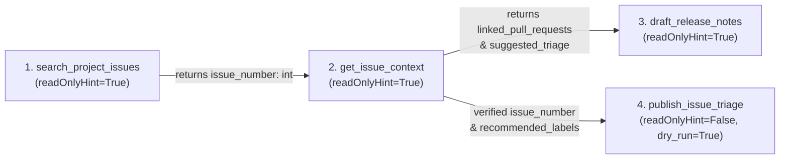

# CS146S Week 2: Build an MCP Server for a Third-Party API

**Course:** Stanford CS146S — The Modern Software Developer (Fall 2026)  
**Server Name:** `github-release-workflow-mcp`  
**Implementation Files:**
- [`server.py`](file:///Users/yixin0909zhang/Downloads/GDG/ai-agents-courses-homework/05-stanford-cs146s/week2/server.py) — MCP JSON-RPC 2.0 stdio server & 4 composing tools
- [`oauth_client.py`](file:///Users/yixin0909zhang/Downloads/GDG/ai-agents-courses-homework/05-stanford-cs146s/week2/oauth_client.py) — OAuth 2.0 Authorization Code + PKCE (RFC 7636 `S256`) client, `0600` local cache, & silent refresh
- [`.mcp.json.example`](file:///Users/yixin0909zhang/Downloads/GDG/ai-agents-courses-homework/05-stanford-cs146s/week2/.mcp.json.example) — Sanitized MCP server configuration for Claude Code / Cursor
- [`test_mcp_server.py`](file:///Users/yixin0909zhang/Downloads/GDG/ai-agents-courses-homework/05-stanford-cs146s/week2/test_mcp_server.py) — Unit & protocol-level stdio integration tests (`5 passed`)

---

## Part I: Server Architecture & Composing Tools (25 pts)

### 1.1 Single Command Startup
The server runs over `stdio` using line-delimited JSON-RPC 2.0 (`protocolVersion: "2025-03-26"`) and starts from a single command:

```bash
python3 week2/server.py
```

For deterministic offline testing without live GitHub OAuth credentials, `GITHUB_MCP_OFFLINE_MOCK=1` (enabled by default in test runs) backs the server with an in-memory repository state while exercising the exact same Pydantic input validation, OAuth token-cache expiry logic, tool annotations, and JSON-RPC 2.0 wire protocol.

### 1.2 The Four Composing Tools



| Tool Name | Mode & Annotations | Input Contract | Output Contract & Composition Link |
| :--- | :--- | :--- | :--- |
| `search_project_issues` | **Read** (`readOnlyHint: true`, `idempotentHint: true`) | `repo` (`owner/name` regex), `state` (`Literal["open", "closed", "all"]`), `severity` (`Literal["critical", "high", "medium", "low", "any"]`), `sort_by` (`Literal["updated", "created", "comments"]`), `limit` (`1..50`) | Returns shaped `issues` list containing `issue_number: int`, `title`, `state`, `severity`, `labels`, `milestone`, `updated_at`. |
| `get_issue_context` | **Read** (`readOnlyHint: true`, `idempotentHint: true`) | `repo`, `issue_number: int` ($\ge 1$, from `search_project_issues`) | Returns full `body`, `recent_comments`, `linked_pull_requests`, and `suggested_triage` (`recommended_labels`, `recommended_milestone`). |
| `draft_release_notes` | **Read** (`readOnlyHint: true`, `openWorldHint: false`) | `repo`, `milestone_or_tag`, `issue_numbers: list[int]` ($1..30$), `format_style` (`Literal["keep-a-changelog", "executive-summary", "markdown-bullets"]`) | Aggregates multiple `issue_numbers` into categorized release notes (`markdown_release_notes`) and `counts` (`breaking_changes`, `enhancements`, `bug_fixes`). |
| `publish_issue_triage` | **Write** (`readOnlyHint: false`, `idempotentHint: true`) | `repo`, `issue_number: int`, `add_labels: list[Literal[...]]`, `milestone`, `comment_body` ($10..4000$ chars), `new_state`, **`dry_run: bool = True`** | When `dry_run=True`, returns `planned_mutations` diff without side effects. When `dry_run=False`, mutates labels, milestone, state, and comments. |

---

## Part II: Agent Ergonomics Design Decisions (30 pts)

### 2.1 Constraints in the Schema, Not Just Prose
In [`server.py`](file:///Users/yixin0909zhang/Downloads/GDG/ai-agents-courses-homework/05-stanford-cs146s/week2/server.py), every tool input model inherits from Pydantic `BaseModel` with `ConfigDict(extra="forbid")` and encodes domain constraints directly in JSON Schema:
- **Enumerations via `Literal`:** `state: Literal["open", "closed", "all"]`, `severity: Literal["critical", "high", "medium", "low", "any"]`, `format_style: Literal["keep-a-changelog", "executive-summary", "markdown-bullets"]`, and `add_labels: list[Literal["bug", "enhancement", "security", "breaking-change", "triaged", "release-ready"]]`.
- **Regex & Numeric Bounds:** `repo` enforces `pattern=r"^[A-Za-z0-9_.-]+/[A-Za-z0-9_.-]+$"`, `limit` enforces `ge=1, le=50`, and `issue_numbers` enforces `min_length=1, max_length=30`.

### 2.2 Output Shaping (Eliminating Raw GitHub API Bloat)
A raw GitHub REST API `/repos/{owner}/{repo}/issues` response returns ~85 fields per issue (`node_id`, `avatar_url`, `followers_url`, `events_url`, `reactions`, etc.), consuming ~2,500 tokens per issue. [`GitHubWorkflowService.search_project_issues`](file:///Users/yixin0909zhang/Downloads/GDG/ai-agents-courses-homework/05-stanford-cs146s/week2/server.py#L220-L263) strips 90% of that payload and returns only the 8 fields an agent needs to decide which issue to inspect next (`issue_number`, `title`, `state`, `severity`, `labels`, `milestone`, `comments_count`, `updated_at`), plus a `next_step_hint` field.

### 2.3 Errors as Structured Data (`retryable: False` vs. `retryable: True`)
Unchecked Python exceptions terminate an MCP tool turn with an opaque traceback. [`MCPServerRuntime.invoke_tool`](file:///Users/yixin0909zhang/Downloads/GDG/ai-agents-courses-homework/05-stanford-cs146s/week2/server.py#L462-L505) catches both `ValidationError` and `OAuthToolError`, returning structured JSON with `isError: True` and explicit `retryable` semantics:
- **Non-retryable (`retryable: False`):** Bad `issue_number` (`ISSUE_NOT_FOUND`, listing valid IDs in `remediation`), invalid schema argument (`SCHEMA_VALIDATION_ERROR`), or revoked OAuth refresh token (`OAUTH_REAUTH_REQUIRED`).
- **Retryable (`retryable: True`):** HTTP 429 rate limiting (`GITHUB_RATE_LIMITED` / `OAUTH_RATE_LIMITED`), which includes `"retry_after_seconds": 42` so the agent knows to wait before retrying.

### 2.4 Write Tool Safety Brake (`dry_run: bool = True`)
`publish_issue_triage` carries MCP tool annotation `"readOnlyHint": False` and defaults `dry_run: bool = True`. If an agent invokes `publish_issue_triage` without explicitly setting `dry_run=False`, the server computes and returns the exact before/after diff (`labels_before` $\rightarrow$ `labels_after`, `state_before` $\rightarrow$ `state_after`, `comment_to_append`) with `"applied": False`, preventing accidental issue closures or spam comments.

---

## Part III: OAuth 2.0 Implementation & Security (25 pts)

Implemented in [`oauth_client.py`](file:///Users/yixin0909zhang/Downloads/GDG/ai-agents-courses-homework/05-stanford-cs146s/week2/oauth_client.py):
1. **Authorization Code + PKCE (`S256`):** [`generate_pkce_challenge`](file:///Users/yixin0909zhang/Downloads/GDG/ai-agents-courses-homework/05-stanford-cs146s/week2/oauth_client.py#L96-L106) generates a 32-byte cryptographic `code_verifier` and computes `BASE64URL(SHA256(code_verifier))`. [`exchange_code_for_token`](file:///Users/yixin0909zhang/Downloads/GDG/ai-agents-courses-homework/05-stanford-cs146s/week2/oauth_client.py#L156-L189) verifies `state` using constant-time `secrets.compare_digest` and exchanges the code + `code_verifier` at `https://github.com/login/oauth/access_token`.
2. **Atomic `0600` Caching & Silent Refresh:** Tokens are written atomically via `.tmp` rename with `0600` (`stat.S_IRUSR | stat.S_IWUSR`) permissions. [`get_valid_access_token`](file:///Users/yixin0909zhang/Downloads/GDG/ai-agents-courses-homework/05-stanford-cs146s/week2/oauth_client.py#L239-L260) checks `cached.is_expired(margin_seconds=60)` and transparently calls `refresh_access_token(cached.refresh_token)` when the access token is within 60 seconds of expiry.
3. **Minimal Scopes Justification:**
   - Read-only mode (`write_access=False`) requests only `repo:status`.
   - Write-enabled mode (`write_access=True`) requests `repo:status` and `public_repo` (the minimal GitHub OAuth scopes required to read/triage public repository issues without granting `admin:org`, `delete_repo`, or `workflow` privileges).
4. **Mid-Session Token Death Without Browser Popups:** If both the access token and refresh token expire or are revoked mid-session, `refresh_access_token` **never** calls `webbrowser.open()` (which would hang a headless stdio server). Instead, it returns:
   ```json
   {
     "ok": false,
     "error_code": "OAUTH_REAUTH_REQUIRED",
     "error": "OAuth provider rejected refresh_token (bad_refresh_token): The refresh token has been revoked.",
     "retryable": false,
     "remediation": "Token died mid-session (refresh token revoked/expired). Do NOT retry. Instruct the user to run `python3 week2/oauth_client.py --login`."
   }
   ```

---

## Part IV: End-to-End Integration & Failure Transcripts (20 pts)

### 4.1 End-to-End Multi-Tool Chained Transcript
**User Prompt:**
> *"Find all open issues in `stanford-oval/storm`, inspect the high-severity bug to see if its fix PR merged, draft Keep-a-Changelog release notes for `v2.4.0` across issues 101, 104, and 109, and triage issue #101 as `release-ready` and closed (previewing with dry_run first)."*

1. **Tool Call 1 — `search_project_issues`:**
   - *Arguments:* `{"repo": "stanford-oval/storm", "state": "open", "severity": "any", "sort_by": "updated"}`
   - *Shaped Result:* Returns `issue_number: 104` (*"Add token-budget cutoff telemetry..."*, `severity: "medium"`) and `issue_number: 101` (*"Fix citation deduplication crash..."*, `severity: "high"`).
2. **Tool Call 2 — `get_issue_context` (chaining `issue_number: 101` from Call 1):**
   - *Arguments:* `{"repo": "stanford-oval/storm", "issue_number": 101}`
   - *Shaped Result:* Confirms `linked_pull_requests: [{"pr_number": 118, "title": "Canonicalize URLs before citation merge", "merged": true}]` and `suggested_triage: {"recommended_labels": ["triaged", "bug", "release-ready"], "recommended_milestone": "v2.4.0"}`.
3. **Tool Call 3 — `draft_release_notes` (chaining `[101, 104, 109]`):**
   - *Arguments:* `{"repo": "stanford-oval/storm", "milestone_or_tag": "v2.4.0", "issue_numbers": [101, 104, 109], "format_style": "keep-a-changelog"}`
   - *Shaped Result:* Produces categorized Markdown under `### Breaking Changes` (`#109`), `### Added & Improved` (`#104`), and `### Fixed` (`#101`).
4. **Tool Call 4a — `publish_issue_triage` (Safety Brake `dry_run=True`):**
   - *Arguments:* `{"repo": "stanford-oval/storm", "issue_number": 101, "add_labels": ["triaged", "release-ready"], "milestone": "v2.4.0", "comment_body": "Verified fix in PR #118; queued for v2.4.0 release notes.", "new_state": "closed", "dry_run": true}`
   - *Shaped Result:* Returns `"applied": false` and `planned_mutations` showing `state_before: "open" -> state_after: "closed"` and `labels_after: ["bug", "release-ready", "severity:high", "triaged"]`.
5. **Tool Call 4b — `publish_issue_triage` (Commit `dry_run=False`):**
   - *Arguments:* Same as 4a with `"dry_run": false`.
   - *Shaped Result:* Returns `"applied": true`, `"state": "closed"`, `"comments_count": 3`.

### 4.2 Demonstrated Failure & Error-Recovery Path
When the agent requests a non-existent issue (`get_issue_context(repo="stanford-oval/storm", issue_number=9999)`), the server returns `isError: True` with actionable recovery data:
```json
{
  "ok": false,
  "error_code": "ISSUE_NOT_FOUND",
  "error": "Issue #9999 does not exist in repository 'stanford-oval/storm'.",
  "retryable": false,
  "remediation": "Do NOT retry with issue_number=9999. Call `search_project_issues(repo='stanford-oval/storm', state='all')` to find valid issue numbers (known IDs in 'stanford-oval/storm': [101, 104, 109])."
}
```
Instead of blindly retrying `#9999` or crashing on a Python `KeyError`, the agent reads `retryable: false` and switches to valid IDs `[101, 104, 109]`.
